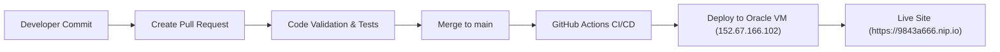

# IELTS Master: Full-Stack Practice & Improvement Platform

[](https://github.com/sdebjit/ielts-practice-test/actions/workflows/deploy.yml)
[](https://9843a666.nip.io)
[](https://python.org)
[](https://github.com/sdebjit/ielts-practice-test)

A full-stack, production-grade IELTS preparation platform tailored to systematically improve your scores across all 4 segments: **LISTENING**, **READING**, **WRITING**, and **SPEAKING**.

**Live Production URL:** [https://9843a666.nip.io](https://9843a666.nip.io)

---

## 🌟 Key Features

### 1. 📚 600 Authentic Cambridge Test Bank (Academic & General Training)
* **Listening (120 Tests)**: Shared across both Academic and General Training. Full 4-part structure with Web Speech audio simulation, wave visualizers, variable playback speeds (`0.85x` to `1.2x`), and distractor analysis.
* **Academic Reading (120 Tests, `R-01` to `R-120`)**:
  * 3 long academic texts (~2,700 words per test).
  * Split-screen interface with text highlighter, font scaling, and 60-minute exam timer.
  * Standard Cambridge questions: True/False/Not Given, Matching Headings, Summary Completion, Multiple Choice.
* **General Training Reading (60 Tests, `GTR-01` to `GTR-60`)**:
  * **Section 1 (Q1–14)**: Everyday social notices, course guides, and timetables.
  * **Section 2 (Q15–27)**: Workplace contexts, company policies, health & safety handbooks.
  * **Section 3 (Q28–40)**: General interest long-form reading articles.
  * Dedicated official GT raw-to-band scoring conversion (e.g. 30/40 is Band 6.5 in GT vs Band 7.0 in Academic).
* **Academic Writing (120 Tasks, `W-01` to `W-120`)**:
  * **Task 1**: Data reports, charts, tables, diagrams (150-word minimum).
  * **Task 2**: Discursive essays with thesis and counterarguments (250-word minimum).
* **General Training Writing (60 Tasks, `GTW-01` to `GTW-60`)**:
  * **Task 1: Letter Writing**: Formal letters (complaints, petitions), semi-formal letters (landlords, managers), and informal letters (friends, colleagues). Evaluates salutation, tone/register, and 3-bullet coverage.
  * **Task 2: Discursive Essay**: General training discursive topics with Band 9 model answers.
* **Speaking Mock Interview (120 Tests)**:
  * Full 3-part guided simulation: Part 1 interview, Part 2 cue card with prep countdown, Part 3 abstract discussion.
  * Interactive examiner voice synthesis and speech recognition transcription.

### 2. 🤖 Gemini AI Examiner Evaluation
* Rigorous assessment against official 9-band descriptors:
  1. *Task Achievement / Task Response*
  2. *Coherence & Cohesion*
  3. *Lexical Resource*
  4. *Grammatical Range & Accuracy*
* Detailed line-by-line grammar corrections and Band 8+ vocabulary upgrade recommendations with 1-click notebook saving.

### 3. 🌓 Modern UI & Candidate Features
* **Simplistic Dark/Light Mode**: Single-click header toggle persisted across candidate sessions.
* **Multi-User Authentication**: PBKDF2-HMAC-SHA256 password hashing with per-user salt and isolated score progress tracking.
* **Diagnostic Radar & Progress Analytics**: Identifies whether distractors, True/False vs Not Given, or grammar range are pulling down scores.

---

## 🏗️ Architecture & Modular Codebase

```
ielts-practice-test/
├── .github/
│   └── workflows/
│       └── deploy.yml          # Automated CI/CD pipeline (Test, Lint, Deploy)
├── backend/
│   ├── server.py               # Standalone Python HTTP server & REST API
│   ├── database.py             # SQLite storage, auth, sessions, attempts, test bank
│   ├── analytics.py            # Diagnostic engine, official IELTS band rounding
│   ├── gemini_service.py       # Google Gemini REST client & heuristic examiner
│   ├── seed_data.py            # Test bank orchestrator & auto-seeding engine
│   ├── cambridge_listening_bank.py
│   ├── cambridge_reading_bank.py
│   ├── cambridge_writing_bank.py
│   ├── cambridge_speaking_bank.py
│   └── cambridge_gt_bank.py    # Dedicated 120 General Training test bank
├── frontend/
│   ├── index.html              # Responsive single-page application
│   ├── styles.css              # Custom styling, animations, and dark mode
│   ├── app.js                  # Consolidated distribution script
│   └── js/                     # Modular frontend scripts
│       ├── state.js            # Reactive application state
│       ├── utils.js            # Helpers and theme toggle logic
│       ├── timers.js           # Independent countdown timers
│       ├── auth.js             # Authentication, session, modal handlers
│       ├── settings.js         # Settings & exam syllabus toggles
│       ├── dashboard.js        # Analytics charts & diagnostic radar
│       ├── catalog.js          # Test catalog & randomized exam pickers
│       ├── audio.js            # Speech synthesis & audio visualizers
│       ├── listening.js        # Listening exam simulator
│       ├── reading.js          # Split-screen reading test & highlighter
│       ├── writing.js          # Writing editor, word count & AI evaluation
│       ├── speaking.js         # Speaking live interview simulator
│       ├── vocabulary.js       # Academic vocabulary notebook
│       └── app.js              # View router and bootstrap orchestrator
├── nginx/
│   └── ielts-master.conf       # Reverse proxy with Let's Encrypt SSL configuration
├── systemd/
│   └── ielts-master.service    # Production daemon service file
├── deploy_oracle.sh            # Automated VM provisioner & firewall configuration
└── README.md
```

---

## 🚀 CI/CD Pipeline & Deployment

This repository uses **GitHub Actions** for continuous integration and automated deployment directly to the Oracle Cloud production VM whenever code is merged into `main`:



### GitHub Actions Secrets
The following secrets are configured under **Settings > Secrets and variables > Actions**:
* `SSH_PRIVATE_KEY`: Private SSH key for Oracle Cloud VM authentication.
* `SERVER_IP`: Production server IP (`152.67.166.102`).
* `SERVER_USER`: Service user (`ubuntu`).

---

## 🔄 Pull Request & Contribution Workflow

All new features, improvements, and bug fixes must follow the PR workflow:

1. **Create a Feature Branch**:
   ```bash
   git checkout -b feature/your-feature-name
   ```
2. **Make and Test Changes Locally**:
   ```bash
   python3 -m py_compile backend/*.py
   ./start.sh 8080
   ```
3. **Commit & Push to GitHub**:
   ```bash
   git add .
   git commit -m "feat: description of changes"
   git push -u origin feature/your-feature-name
   ```
4. **Open a Detailed Pull Request**:
   ```bash
   gh pr create --title "feat: your feature title" --body "Detailed summary of changes"
   ```
5. **Merge to `main`**:
   Once the PR validation checks pass, merge the PR into `main`. The CI/CD pipeline will automatically deploy the latest changes to production.
